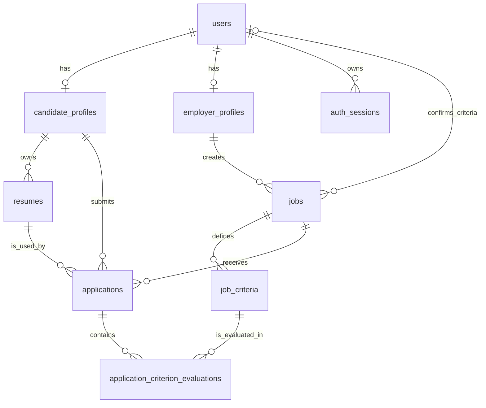

# Celeta — Especificação do Banco de Dados

**Versão:** 2.0  
**SGBD:** MySQL 8.0.16+  
**Engine:** InnoDB  
**Charset:** utf8mb4  
**Idioma dos identificadores:** inglês  
**Convenção SQL:** `snake_case`, tabelas no plural

## 1. Objetivo e decisões

Este esquema persiste os dados necessários ao MVP da Celeta: usuários, perfis, vagas, critérios, currículos, candidaturas e avaliações assistidas por IA.

Decisões consolidadas:

- Manter MySQL; não migrar para Supabase/PostgreSQL.
- Usar inglês nos nomes de tabelas, colunas e estados, alinhado ao backend.
- Gerar UUID v4 na aplicação e armazenar como `CHAR(36)`.
- Usar `VARCHAR + CHECK` para estados controlados, sem `ENUM`.
- Usar `DATETIME(3)` em UTC.
- Usar JSON apenas para estruturas flexíveis de exibição e perfil.
- Guardar arquivos fora do banco; persistir somente uma chave privada de armazenamento.
- Usar constraints compostas para impedir que uma candidatura referencie currículo de outro candidato ou avaliação de critério de outra vaga.
- Separar classificação da IA, estado operacional da triagem, status de candidatura e fase de seleção.

O DDL de referência está em `celeta_database_v2.sql`.

## 2. Convenções

| Item | Convenção |
|---|---|
| Tabelas | Plural em `snake_case`: `candidate_profiles` |
| Colunas | `snake_case`: `created_at`, `candidate_profile_id` |
| Chave primária | `id` em cada tabela |
| Chaves estrangeiras | Nome da entidade referenciada + `_id` |
| Identificadores | UUID v4, `CHAR(36)`, gerado pelo backend |
| Datas | UTC, `DATETIME(3)` |
| Exclusão | Não excluir registros de negócio fisicamente durante o fluxo normal; desativar conta ou executar processo de retenção controlado |
| Engine | InnoDB, para transações e integridade referencial |

O backend converte `snake_case` para `camelCase` nas respostas JSON. Exemplo: `candidate_profile_id` no SQL corresponde a `candidateProfileId` na API.

## 3. Entidades e responsabilidades

| Entidade de domínio | Tabela | Responsabilidade |
|---|---|---|
| `User` | `users` | Conta, credenciais, papel e situação de acesso. |
| `AuthSession` | `auth_sessions` | Sessões autenticadas com expiração e revogação. |
| `CandidateProfile` | `candidate_profiles` | Dados profissionais e contato do candidato. |
| `EmployerProfile` | `employer_profiles` | Empresa ou contratante responsável por vagas. |
| `Job` | `jobs` | Descrição, requisitos, publicação e confirmação dos critérios. |
| `JobCriterion` | `job_criteria` | Critério individual de avaliação da vaga. |
| `Resume` | `resumes` | Metadados, localização privada e texto extraído do PDF. |
| `Application` | `applications` | Relação candidato-vaga, currículo usado, status, fase e resultado geral da triagem. |
| `ApplicationCriterionEvaluation` | `application_criterion_evaluations` | Resultado e evidência de cada critério em uma candidatura. |

`JobRequirement` não é uma tabela separada no MVP: os requisitos estruturados para exibição ficam em `jobs.requirements_json`. `Screening` é uma operação de domínio, não uma tabela independente: o resumo e o estado ficam em `applications`, e as avaliações individuais ficam em `application_criterion_evaluations`.

## 4. Relacionamentos

Restrições importantes:

- `candidate_profiles.user_id` é único: no máximo um perfil de candidato por usuário.
- `employer_profiles.user_id` é único: no máximo um perfil de contratante por usuário.
- `applications(job_id, candidate_profile_id)` é único: uma candidatura por candidato e vaga.
- A FK composta de `applications(resume_id, candidate_profile_id)` garante que o currículo pertença ao candidato da candidatura.
- As FKs compostas das avaliações garantem que o critério avaliado pertença à mesma vaga da candidatura.
- O backend garante que o papel do usuário corresponda ao perfil criado e que somente o proprietário gerencie seus recursos.

## 5. Dicionário de dados

### 5.1. `users`

Conta de autenticação da aplicação.

| Coluna | Tipo | Regra |
|---|---|---|
| `id` | CHAR(36) | PK, UUID v4 |
| `email` | VARCHAR(255) | Obrigatório e único; normalizado para minúsculas na aplicação |
| `password_hash` | VARCHAR(255) | Hash Argon2id; nunca senha pura |
| `role` | VARCHAR(16) | `CANDIDATE` ou `EMPLOYER` |
| `is_active` | BOOLEAN | Padrão TRUE |
| `created_at` / `updated_at` | DATETIME(3) | Auditoria básica |

### 5.2. `auth_sessions`

Sessões de login. O token original nunca é persistido.

| Coluna | Tipo | Regra |
|---|---|---|
| `id` | CHAR(36) | PK |
| `user_id` | CHAR(36) | FK para `users.id` |
| `token_hash` | CHAR(64) | SHA-256 do token aleatório; único |
| `expires_at` | DATETIME(3) | Expiração obrigatória |
| `last_used_at` | DATETIME(3) | Última utilização, opcional |
| `created_at` | DATETIME(3) | Criação |

A API envia o token original em cookie `HttpOnly`; o backend calcula seu hash para localizar a sessão. Logout remove a sessão correspondente.

### 5.3. `candidate_profiles`

Perfil profissional do candidato.

| Coluna | Tipo | Regra |
|---|---|---|
| `id` | CHAR(36) | PK |
| `user_id` | CHAR(36) | FK e UNIQUE para `users.id` |
| `full_name` | VARCHAR(150) | Obrigatório |
| `phone` | VARCHAR(30) | Opcional |
| `professional_area` | VARCHAR(120) | Opcional |
| `skills_json` | JSON | Competências declaradas |
| `career_objectives` | TEXT | Objetivos profissionais |
| `created_at` / `updated_at` | DATETIME(3) | Auditoria básica |

### 5.4. `employer_profiles`

Perfil do contratante/empresa.

| Coluna | Tipo | Regra |
|---|---|---|
| `id` | CHAR(36) | PK |
| `user_id` | CHAR(36) | FK e UNIQUE para `users.id` |
| `company_name` | VARCHAR(150) | Obrigatório |
| `cnpj` | CHAR(14) | Opcional, somente dígitos, único quando informado |
| `description` | TEXT | Opcional |
| `created_at` / `updated_at` | DATETIME(3) | Auditoria básica |

### 5.5. `jobs`

Vagas criadas pelos contratantes.

| Coluna | Tipo | Regra |
|---|---|---|
| `id` | CHAR(36) | PK |
| `employer_profile_id` | CHAR(36) | FK para `employer_profiles.id` |
| `title` | VARCHAR(150) | Obrigatório |
| `description` | TEXT | Descrição original da vaga |
| `requirements_json` | JSON | Requisitos estruturados para exibição/filtros |
| `status` | VARCHAR(16) | `DRAFT`, `PUBLISHED` ou `CLOSED`; padrão `DRAFT` |
| `criteria_confirmed_at` | DATETIME(3) | Nulo até a confirmação do contratante |
| `criteria_confirmed_by_user_id` | CHAR(36) | Usuário que confirmou; nulo até confirmação |
| `published_at` | DATETIME(3) | Data de publicação |
| `closed_at` | DATETIME(3) | Data de encerramento |
| `created_at` / `updated_at` | DATETIME(3) | Auditoria básica |

Os dois campos de confirmação devem estar preenchidos juntos ou permanecer nulos. Quando critérios forem alterados, o backend limpa ambos. O estado `PUBLISHED` exige critérios confirmados; a regra que verifica a existência de pelo menos um critério é aplicada no caso de uso.

### 5.6. `job_criteria`

Critérios confirmados que orientam a triagem.

| Coluna | Tipo | Regra |
|---|---|---|
| `id` | CHAR(36) | PK |
| `job_id` | CHAR(36) | FK para `jobs.id` |
| `name` | VARCHAR(150) | Nome legível do critério |
| `details` | TEXT | Orientação contextual para avaliação |
| `criterion_type` | VARCHAR(12) | `REQUIRED` ou `DESIRABLE` |
| `weight` | DECIMAL(5,2) | Peso numérico positivo, padrão 1.00 |
| `sort_order` | SMALLINT UNSIGNED | Ordem de exibição, padrão 0 |
| `created_at` / `updated_at` | DATETIME(3) | Auditoria básica |

`criterion_type` e `weight` não são sinônimos. O primeiro identifica obrigatoriedade; o segundo participa do cálculo do score.

### 5.7. `resumes`

Currículos cadastrados pelo candidato.

| Coluna | Tipo | Regra |
|---|---|---|
| `id` | CHAR(36) | PK |
| `candidate_profile_id` | CHAR(36) | FK para `candidate_profiles.id` |
| `title` | VARCHAR(100) | Nome apresentado ao candidato |
| `storage_key` | VARCHAR(500) | Chave/caminho interno privado; único |
| `file_size_bytes` | INT UNSIGNED | Tamanho do arquivo |
| `extracted_text` | LONGTEXT | Texto extraído do PDF, acessível somente pelo backend |
| `extraction_status` | VARCHAR(12) | `PENDING`, `COMPLETED` ou `FAILED` |
| `created_at` / `updated_at` | DATETIME(3) | Auditoria básica |

O arquivo PDF não fica no MySQL nem em diretório público. `storage_key` não é URL pública e não deve ser devolvido em respostas abertas da API.

### 5.8. `applications`

Candidatura do candidato a uma vaga.

| Coluna | Tipo | Regra |
|---|---|---|
| `id` | CHAR(36) | PK |
| `job_id` | CHAR(36) | FK para `jobs.id` |
| `candidate_profile_id` | CHAR(36) | Parte da FK composta do currículo |
| `resume_id` | CHAR(36) | Currículo usado na candidatura |
| `status` | VARCHAR(16) | `IN_REVIEW`, `ADVANCED` ou `NOT_SELECTED`; padrão `IN_REVIEW` |
| `selection_phase` | VARCHAR(12) | `BLIND` ou `IDENTIFIED`; padrão `BLIND` |
| `screening_status` | VARCHAR(12) | `PENDING`, `PROCESSING`, `COMPLETED` ou `FAILED` |
| `ai_classification` | VARCHAR(16) | `ELIGIBLE`, `NOT_ELIGIBLE` ou `REVIEW_REQUIRED`; nulo antes da análise |
| `compatibility_score` | DECIMAL(5,2) | Score de 0.00 a 100.00; pode ser nulo |
| `ai_summary` | TEXT | Resumo justificável da triagem |
| `screening_started_at` | DATETIME(3) | Início da análise |
| `screening_completed_at` | DATETIME(3) | Conclusão da análise |
| `applied_at` | DATETIME(3) | Data da candidatura |
| `created_at` / `updated_at` | DATETIME(3) | Auditoria básica |

Significado dos campos independentes:

- `screening_status`: estado técnico do processamento da IA.
- `ai_classification`: recomendação inicial derivada da análise.
- `status`: decisão humana sobre o andamento da candidatura.
- `selection_phase`: controla quais informações o contratante pode acessar.

`UNIQUE(job_id, candidate_profile_id)` impede duplicidade. A FK composta `(resume_id, candidate_profile_id)` garante a propriedade do currículo.

### 5.9. `application_criterion_evaluations`

Resultado individual de cada critério na triagem de uma candidatura.

| Coluna | Tipo | Regra |
|---|---|---|
| `id` | CHAR(36) | PK |
| `application_id` | CHAR(36) | FK composta para `applications` |
| `job_id` | CHAR(36) | Parte das FKs compostas de integridade |
| `criterion_id` | CHAR(36) | FK composta para `job_criteria` |
| `result` | VARCHAR(24) | `MET`, `NOT_MET` ou `INSUFFICIENT_EVIDENCE` |
| `evidence_text` | TEXT | Trecho/evidência encontrada, quando houver |
| `created_at` / `updated_at` | DATETIME(3) | Auditoria básica |

`UNIQUE(application_id, criterion_id)` impede avaliação duplicada do mesmo critério na mesma candidatura. As FKs compostas garantem que a avaliação só relacione uma candidatura e um critério da mesma vaga.

## 6. Valores oficiais

| Campo | Valores permitidos |
|---|---|
| `users.role` | `CANDIDATE`, `EMPLOYER` |
| `jobs.status` | `DRAFT`, `PUBLISHED`, `CLOSED` |
| `job_criteria.criterion_type` | `REQUIRED`, `DESIRABLE` |
| `resumes.extraction_status` | `PENDING`, `COMPLETED`, `FAILED` |
| `applications.status` | `IN_REVIEW`, `ADVANCED`, `NOT_SELECTED` |
| `applications.selection_phase` | `BLIND`, `IDENTIFIED` |
| `applications.screening_status` | `PENDING`, `PROCESSING`, `COMPLETED`, `FAILED` |
| `applications.ai_classification` | `ELIGIBLE`, `NOT_ELIGIBLE`, `REVIEW_REQUIRED` |
| `application_criterion_evaluations.result` | `MET`, `NOT_MET`, `INSUFFICIENT_EVIDENCE` |

Os estados armazenados no banco são técnicos. A interface traduz esses valores para português.

## 7. Regras que ficam no backend

O banco garante integridade estrutural, mas as seguintes regras precisam ser aplicadas nos casos de uso:

1. Usuário `CANDIDATE` só pode ter perfil de candidato; `EMPLOYER` só pode ter perfil de contratante.
2. Somente o contratante proprietário pode alterar vaga, critérios e candidaturas daquela vaga.
3. Publicação exige vaga válida, pelo menos um critério e confirmação pelo contratante.
4. Alterar critérios limpa a confirmação anterior.
5. Candidatura só pode ser criada para vaga `PUBLISHED` e currículo do candidato autenticado.
6. Avançar candidatura altera `status` para `ADVANCED` e `selection_phase` para `IDENTIFIED` na mesma transação.
7. A API nunca retorna identidade ou arquivo de candidatura em fase `BLIND` ao contratante.
8. IA não atualiza `applications.status` nem decide contratação.
9. Falha ou falta de evidência resulta em revisão humana, nunca em reprovação automática.
10. Exclusão de registros com histórico deve ser controlada; não remover candidatos, vagas ou currículos que estejam vinculados a candidaturas em andamento.

## 8. Índices

O DDL cria índices para:

- E-mail e hash de sessão (`UNIQUE`).
- Sessões por usuário e expiração.
- Perfis por usuário (`UNIQUE`).
- Vagas por contratante e status.
- Pesquisa textual (`FULLTEXT` em `jobs.title` e `jobs.description`).
- Critérios por vaga.
- Currículos por candidato e storage key (`UNIQUE`).
- Candidaturas por vaga/status/score e por candidato/data.
- Avaliações por candidatura/critério (`UNIQUE`).

A busca semântica avançada e índices vetoriais ficam fora do MVP.

## 9. Operação e manutenção

- Configurar o MySQL em UTC.
- Gerar UUID no backend usando `crypto.randomUUID()`; não depender de `DEFAULT UUID()` no banco.
- Usar parâmetros em todas as consultas.
- Executar migrations SQL versionadas e revisar scripts antes da aplicação.
- Fazer backup recorrente do banco e do volume privado de currículos.
- Testar restauração dos backups.
- Não expor MySQL à internet; aceitar conexão somente da API e da rede interna.
- Não armazenar secrets no banco ou no repositório.

## 10. Arquivos do esquema

- `celeta_database_v2.sql`: DDL inicial executável para MySQL 8.0.16+.
- `celeta_backend_v2.md`: regras e contratos que consomem este esquema.

---

## 11. Estado do banco de referência (dump de 2026-11-02)

Base de referência: `celeta_db`, MySQL 8.4.13, dump `celeta_db_backup.sql`. Tabelas vazias (sem dados).

Este dump confirma o esquema da seção 5 com estas diferenças e observações:

| Item | Dump | Observação |
|---|---|---|
| `job_criteria.weight` | `CHECK (weight > 0 AND weight <= 10)` | Spec diz só "positivo". Limite `10` precisa entrar na spec ou ser removido |
| `applications.candidate_profile_id` | Sem FK direta para `candidate_profiles` | Integridade vem pela FK composta com `resumes`. Recomendado adicionar FK direta |
| Chaves únicas extras | `uq_applications_id_job`, `uq_resumes_id_candidate`, `uq_job_criteria_id_job` | Necessárias para as FKs compostas. Documentar como parte do esquema |
| `employer_profiles.cnpj` | `UNIQUE` | Único, mesmo quando nulo (MySQL permite múltiplos NULL) |
| `FK auth_sessions.user_id` | `ON DELETE CASCADE` | Spec não cita. Aceitável: sessão sem usuário não tem uso |
| `FK candidate_profiles.user_id` e `employer_profiles.user_id` | `ON DELETE RESTRICT` | Coerente com a regra de não excluir registros com histórico |
| `application_criterion_evaluations` | `ON DELETE CASCADE` a partir de `applications` | Avaliações somem com a candidatura. Confirmar se é o desejado |
| Migrations | Sem tabela de controle de versão | Definir em T02 |
| DDL de referência | `celeta_database_v2.sql` citado na spec, não existe no repositório | Criar em T02 a partir deste esquema |

Versão do servidor: MySQL 8.4.13 (LTS). A spec pede 8.0.16+, então está compatível.

## 12. DDL de referência (aceito)

O arquivo `celeta_database_v2.sql` na raiz do repositório é o DDL oficial do esquema. Ele foi usado para criar o banco local e substitui a seção 11 como referência.

As diferenças da seção 11 foram revisadas e aceitas como estão:

- Peso de critério limitado a `0 < weight <= 10`.
- Sem FK direta de `applications.candidate_profile_id`. A integridade vem da FK composta com `resumes`.
- Avaliações removidas em cascata quando a candidatura é removida.

Índices e chaves únicas extras servem às FKs compostas e permanecem.
